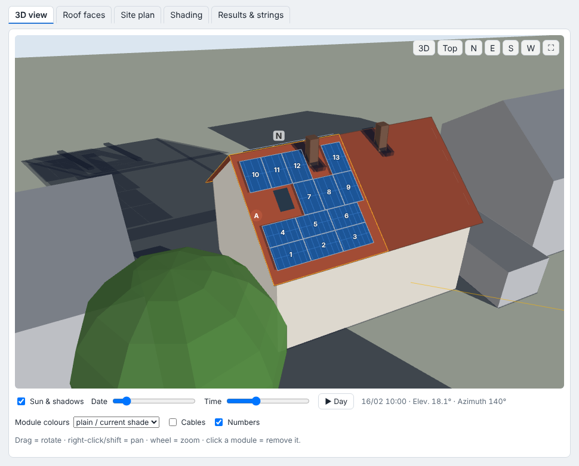
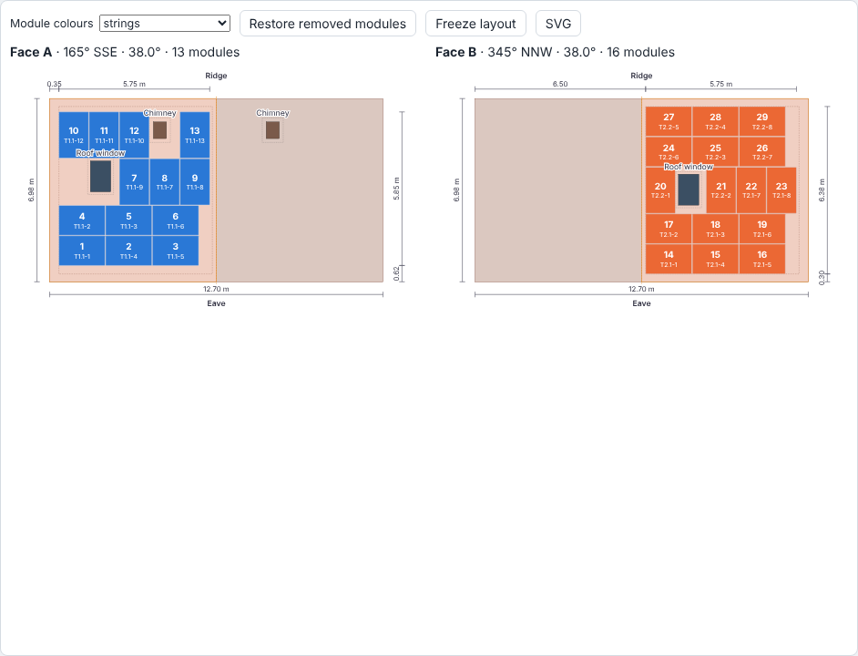
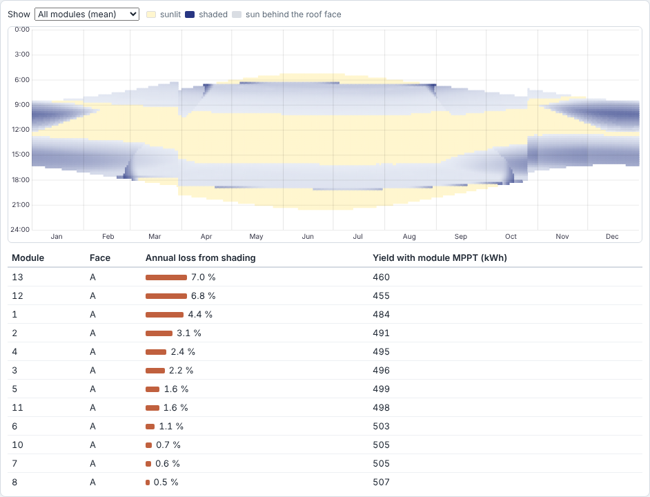
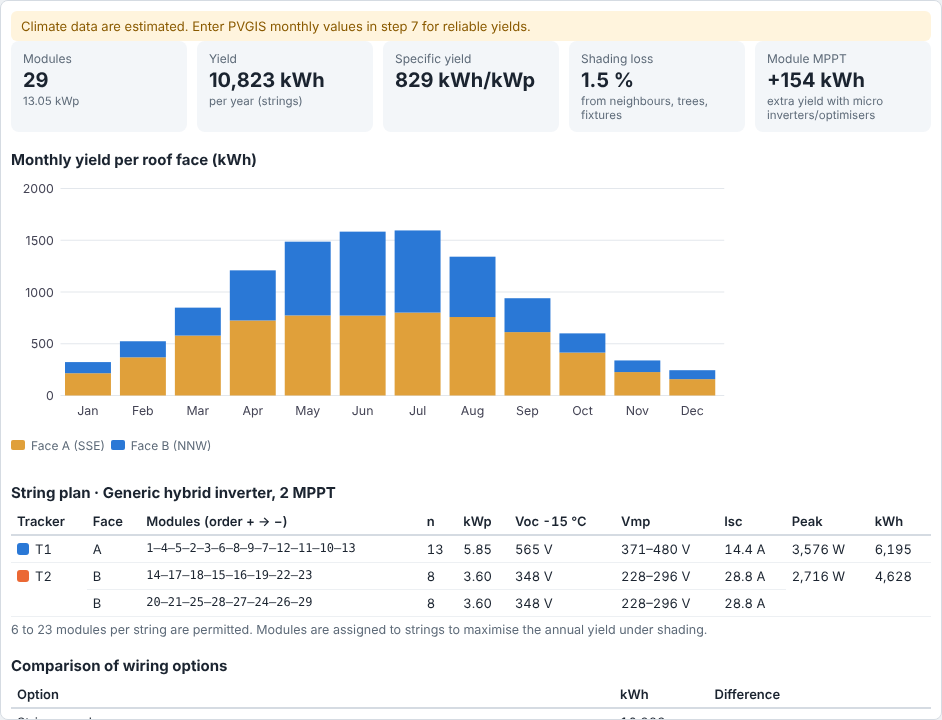

# PV Roof Planner

**3D-Verschattungsanalyse, PV-Belegung und Stringplanung für Satteldächer – komplett im Browser.**
*3D shading analysis, PV module layout and string planning for gable roofs – entirely in the browser.* ([English below](#english))



## Was das Werkzeug kann

- **Eigenes Haus als 3D-Modell:** Satteldach mit beliebiger Ausrichtung und Neigung, unterschiedliche Dachüberstände, Doppel- und Reihenhäuser mit eigenem Abschnitt, Kamine, Dachfenster, Lüfter.
- **Umgebung:** Nachbargebäude (Sattel-, Walm-, Flachdach) und Bäume (Laub- oder Nadelbaum, im Winter lichter).
- **Import aus OpenStreetMap:** Adresse suchen, eigenes Haus anklicken, Nachbarhäuser werden mit geschätzten Höhen übernommen.
- **Sonne & Schatten in 3D:** beliebiger Tag und Uhrzeit, Schattenwurf auf Dach, Modulen und Gelände, Tagesablauf als Animation.
- **Maximale Modulbelegung:** automatische Suche über hochkant/quer gemischte Reihen, Randabstände, Abstände zu Aufbauten, fluchtende Spalten. Einzelne Module per Klick entfernen.
- **Jahressimulation der Verschattung:** jede Zelle jedes Moduls, 15–60-Minuten-Raster, Bypassdioden- und Halbzellen-Modell, Verlust je Modul und Jahres-Heatmap.
- **Stringplanung:** zulässige Stringlängen aus Modul- und Wechselrichterdaten (Voc bei Kälte, Vmpp bei Hitze, Ströme), Verteilung auf die MPP-Tracker, Optimierung der Modulzuordnung auf den Jahresertrag unter Verschattung, Vergleich mit Modul-MPPT (Mikrowechselrichter/Optimierer).
- **Kabel:** grobe Längen je String bis zum Wechselrichter, Brückenkabel, Spannungsfall.
- **Export:** Projekt als JSON, Modulliste als CSV, Dachflächenpläne als SVG, 3D-Modell als DXF (CAD), Bericht drucken/als PDF.
- **Deutsch und Englisch.** Keine Installation, kein Server, keine Datenübertragung (außer den OpenStreetMap-Abfragen, die du selbst auslöst).

| Dachflächen mit Stringplan | Verschattung im Jahresverlauf | Ergebnis |
|---|---|---|
|  |  |  |

## Loslegen

- **Online:** <https://nebukadnezzar1.github.io/pv-roof-planner/>
- **Lokal:** Repository herunterladen und `index.html` im Browser öffnen. Es gibt keinen Build-Schritt und keine Abhängigkeiten.

Eine Schritt-für-Schritt-Anleitung steht in [docs/ANLEITUNG.md](docs/ANLEITUNG.md).

### Auf GitHub Pages veröffentlichen

1. Repository auf GitHub anlegen und den Inhalt dieses Ordners hochladen.
2. *Settings → Pages → Build and deployment → Source: „Deploy from a branch“, Branch `main`, Ordner `/ (root)`*.
3. Nach ein bis zwei Minuten läuft die App unter `https://<benutzer>.github.io/<repo>/`.
4. Optional: in `index.html` den Link `id="repoLink"` auf dein Repository setzen.

## Wie gerechnet wird

| Teil | Modell |
|---|---|
| Sonnenstand | NOAA-Näherung (Genauigkeit ca. 0,1–0,3°), Zeitzone/Sommerzeit über die IANA-Zeitzone |
| Einstrahlung | Klarhimmel-Tagesgang, skaliert auf die monatliche Globalstrahlung; Diffusanteil je Monat; Hay-Davies-Himmelsmodell (zirkumsolarer Anteil wird mit der Direktstrahlung verschattet); Bodenreflexion |
| Klima | eigene Monatswerte (z. B. aus [PVGIS](https://re.jrc.ec.europa.eu/pvg_tools/)) oder eine Schätzung aus der geografischen Breite |
| Verschattung | Schattenwurf für jede Zelle per geometrischer Projektion aller Hindernisse (Nachbarhäuser, Aufbauten, Baumkronen als halbtransparente Kugeln) |
| Modul | je Bypass-Abschnitt eine Stromquelle; Halbzellen-Hälften parallel; Abschnittsstrom durch die schwächste Zelle begrenzt; Temperatur über NOCT |
| String/Tracker | Abschnitte unterhalb des Stringstroms werden überbrückt; der Tracker sucht das globale Leistungsmaximum, auch bei parallelen Strings; Strom-, Leistungs- und Spannungsgrenzen des Trackers |
| Optimierung | Belegung: vollständige Suche über Reihenfolgen hochkant/quer und Reihenversatz. Strings: alle zulässigen Aufteilungen je Dachseite, danach Tausch von Modulen zwischen Strings, solange der Jahresertrag steigt |

Das Ergebnis ist eine **Planungsschätzung, kein Ertragsgutachten**. Statik, Dachhaken, Brandschutz und Elektroinstallation müssen Fachleute prüfen.

**Abgleich:** Für ein reales Doppelhaus mit Kamin- und Nachbarverschattung weicht der Jahresertrag dieser App um 0,1 % von einem unabhängig erstellten Python-Modell ab; die Verschattungsverluste je Modul stimmen bis auf etwa 1 Prozentpunkt überein.

### Grenzen der ersten Version

- Nur Satteldächer für das eigene Haus (Nachbarn: Sattel-, Walm-, Flachdach). Keine Gauben, Pult- oder Walmdächer für die eigene PV-Fläche.
- Gelände eben (Nachbarn können ein Höhen-Offset haben).
- Keine stündlichen Wetterdaten (TMY); Monatswerte mit Klarhimmel-Tagesgang.
- Kein Schnee, keine Verschmutzung je Modul, kein Batteriespeicher.
- Höhen aus OpenStreetMap sind oft nur geschätzt – bitte prüfen.

## Projektstruktur

```
index.html            Oberfläche
css/app.css
js/project.js         Datenmodell, Standardwerte, Klima
js/sun.js             Sonnenstand, Zeitzonen
js/geometry.js        Gebäude, Dachflächen, Hindernisse, Nachbarn, Bäume
js/layout.js          Belegungsoptimierung
js/shade.js           Jahres-Verschattung und Einstrahlung
js/energy.js          Modul-/String-/Tracker-Leistung (Bypassdioden)
js/strings.js         Stringgrenzen, Stringoptimierung, Kabellängen
js/render3d.js        WebGL-Renderer ohne Abhängigkeiten
js/plan2d.js          SVG-Pläne, Heatmap, Diagramme
js/osm.js             OpenStreetMap (Nominatim, Overpass)
js/export.js          JSON, CSV, DXF
js/i18n.js            Deutsch/Englisch
js/app.js             Bedienung
examples/             Beispielprojekt
tests/run.js          Tests (node tests/run.js)
```

Der Rechenkern läuft auch in Node.js (`require('./js/shade.js')` usw.), z. B. für Stapelrechnungen.

## Mitmachen

Fehlerberichte und Pull Requests sind willkommen. Bitte vorher `node tests/run.js` laufen lassen. Neue Sprachen: einen Block in `js/i18n.js` kopieren und übersetzen.

## Lizenz und Daten

Code: [MIT](LICENSE). Gebäudedaten aus dem Import: © [OpenStreetMap](https://www.openstreetmap.org/copyright)-Mitwirkende, ODbL. Nominatim und Overpass bitte maßvoll nutzen.

---

<a id="english"></a>
## English

PV Roof Planner is a static web app for home owners and installers. Model your gable-roof house (also semi-detached and terraced houses with your own section), add chimneys, roof windows, neighbouring buildings and trees – or import the buildings from OpenStreetMap – and get:

- an interactive **3D view with sun position and cast shadows** for any day and time,
- the **maximum module layout** (mixed portrait/landscape rows, margins, clearances, aligned columns),
- an **annual shading simulation per cell** with a bypass-diode and half-cut-cell model, a shading heat map and the loss of every module,
- a **string plan** that respects voltage and current limits, distributes strings over the MPP trackers and optimises which module goes into which string, plus a comparison with module-level MPPT (micro inverters/optimisers),
- **cable lengths** and voltage drop, and exports to **JSON, CSV, SVG, DXF** and a printable report.

Everything runs locally in the browser – no build step, no dependencies, no server. Open `index.html` or publish the folder with GitHub Pages (*Settings → Pages → Deploy from branch → main / root*). Step-by-step guide: [docs/GUIDE.md](docs/GUIDE.md).

The method is summarised in the table above (NOAA sun position, monthly irradiation with a clear-sky daily course, Hay–Davies sky model, per-cell geometric shadows, bypass-diode string model with global MPP search). Results are planning estimates, not a yield certificate. Licence: MIT. Imported building data © OpenStreetMap contributors (ODbL).
