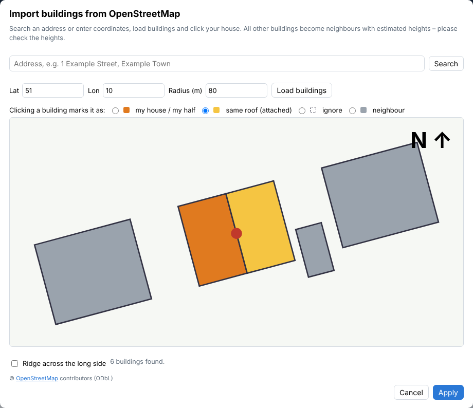

# Anleitung

Die App führt in acht Schritten (links) vom Haus zum Stringplan. Alle Eingaben werden automatisch im Browser gespeichert. Mit **Speichern** sicherst du das Projekt als JSON-Datei, mit **Öffnen** lädst du es wieder.

## 1 Standort

Am einfachsten: **Gebäude aus OpenStreetMap…**

1. Adresse suchen (oder Koordinaten eingeben) und **Gebäude laden**.
2. Dein Haus anklicken (orange). Bei Doppel- oder Reihenhäusern die angebauten Hälften mit dem Modus **gleiches Dach** anklicken (gelb). Gebäude, die nicht stören, auf **ignorieren** setzen.
3. **Übernehmen.** Die App legt das Dach über alle orange und gelb markierten Teile, setzt deinen Abschnitt und übernimmt alle anderen Gebäude als Nachbarn.
4. Danach in Schritt 2 und 4 die Höhen prüfen. OpenStreetMap kennt oft nur die Zahl der Geschosse.

## 2 Gebäude & Dach

- **Seite A** ist die Dachfläche, deren Himmelsrichtung du angibst (180 = Süd). Seite B liegt gegenüber.
- **Länge** = Giebelwand bis Giebelwand, **Tiefe** = Traufwand bis Traufwand, jeweils waagerecht und ohne Überstände.
- **First ab Wand A**: bei symmetrischen Dächern die halbe Tiefe. Ist der First versetzt, ergeben sich unterschiedliche Traufhöhen.
- **Eigener Teil**: Bereich entlang des Firsts, gemessen vom linken Giebel, wenn man von außen auf Seite A schaut. Freistehend: 0 bis Länge.
- Unter den Eingaben zeigt die App Sparrenlängen und Traufhöhen zur Kontrolle.

## 3 Dachaufbauten

Kamine, Dachfenster, Lüfter. Abstände **waagerecht** wie im Grundriss: vom linken Giebel (von außen auf die jeweilige Seite gesehen) und von der Traufwand. Wer auf dem Dach misst, stellt „gemessen“ auf **auf der Dachfläche** (dann ab Tropfkante entlang der Neigung).

- **Oberkante** nur bei Aufbauten, die Schatten werfen (Höhe über Gelände). Dachfenster: 0.
- **Abstand** = Freiraum um den Aufbau, in dem keine Module liegen. Leer = Standardwert aus Schritt 5.
- Auch Kamine des Nachbarn auf der gemeinsamen Dachfläche eintragen – sie werfen Schatten.

## 4 Umgebung

Nachbargebäude als Rechteck: Mitte in Metern östlich (O) und nördlich (N) der Mitte deines Hauses, Länge, Tiefe, Drehung der langen Seite (° von Norden), Traufhöhe, Dachform und Firsthöhe. Aus OpenStreetMap übernommene Gebäude behalten ihren echten Umriss.

Bäume: Position, Gesamthöhe, Kronenradius. Laubbäume lassen im Winter mehr Licht durch.

## 5 Module & Belegung

Werte aus dem Datenblatt: Maße, Leistung, Voc, Vmpp, Impp, Isc, Temperaturkoeffizienten, Zellen und Bypassdioden (meist 3). Die Belegung wird automatisch maximiert:

- **Ausrichtung** automatisch (gemischte hochkant/quer-Reihen), nur hochkant oder nur quer.
- **Raster**: „Spalten fluchtend“ für ein ruhiges Bild, „maximal dicht“ für die letzte Modulreihe neben Aufbauten.
- Randabstände zu Traufe, First, Ortgang und Grenze (Doppelhaus) gelten auf der Dachfläche.

Einzelne Module entfernst du per Klick in der 3D-Ansicht oder im Tab **Dachflächen**. **Belegung festhalten** friert die aktuelle Belegung ein, damit sie sich bei weiteren Änderungen nicht mehr verschiebt.

## 6 Wechselrichter & Strings

Aus dem Datenblatt des Wechselrichters bzw. Ladereglers: Zahl der MPP-Tracker, Strings je Tracker, maximale Eingangsspannung, Start- und MPP-Spannungsbereich, Strom- und Leistungsgrenzen je Tracker. Daraus berechnet die App die zulässige Stringlänge (Voc bei der tiefsten Temperatur, Vmpp bei heißen Modulen).

Unter **Kabelweg** legst du fest, wo die Leitungen das Dach verlassen (Seite und Abstand vom linken Rand an der Traufe) und wie lang der Weg an der Fassade und im Haus ist.

## 7 Klima

Ohne Eingabe schätzt die App die Strahlung aus der geografischen Breite. Genauer: in [PVGIS](https://re.jrc.ec.europa.eu/pvg_tools/) unter *Monthly data* die Monatswerte der Globalstrahlung *H(h)_m* für deinen Standort abrufen und mit **12 Monatswerte einfügen…** übernehmen.

## 8 Berechnen

**Jahressimulation starten.** „Normal“ reicht für Vergleiche, „fein“ für das endgültige Ergebnis. Danach:

- **3D-Ansicht**: Module nach Jahresverlust oder String einfärben, Kabelwege einblenden, mit „Sonne & Schatten“ jeden Zeitpunkt ansehen.
- **Verschattung**: Heatmap über Tag und Jahr, für alle Module, eine Dachseite oder ein einzelnes Modul, und Verlustliste je Modul.
- **Ergebnis & Strings**: Ertrag, Monatsverlauf, Stringplan mit Reihenfolge der Module, Spannungen, Vergleich mit Modul-MPPT, Kabellängen, Exporte.

### Warum ein verschattetes Modul nicht den ganzen String drosselt

Moderne Module sind in Abschnitte mit Bypassdioden geteilt (meist drei). Fällt Schatten auf einen Abschnitt, leitet seine Diode den Strom daran vorbei. Der String läuft mit vollem Strom weiter und verliert nur die Spannung dieses Abschnitts. Der MPP-Tracker sucht das globale Leistungsmaximum. Die App rechnet genau so – deshalb ist der Vorteil von Mikrowechselrichtern oder Optimierern meist klein. Der Vergleich in „Ergebnis & Strings“ zeigt ihn für dein Dach in kWh.

## Tipps

- Mausrad = Zoom, Ziehen = drehen, Rechtsklick oder Shift = verschieben; auf dem Handy mit zwei Fingern zoomen.
- Der DXF-Export (Meter, Ebenen für Dach, Module, Nachbarn …) lässt sich in jedem CAD-Programm öffnen.
- „Bericht drucken / PDF“ erzeugt eine Zusammenfassung mit 3D-Bild, Plänen und Tabellen.
